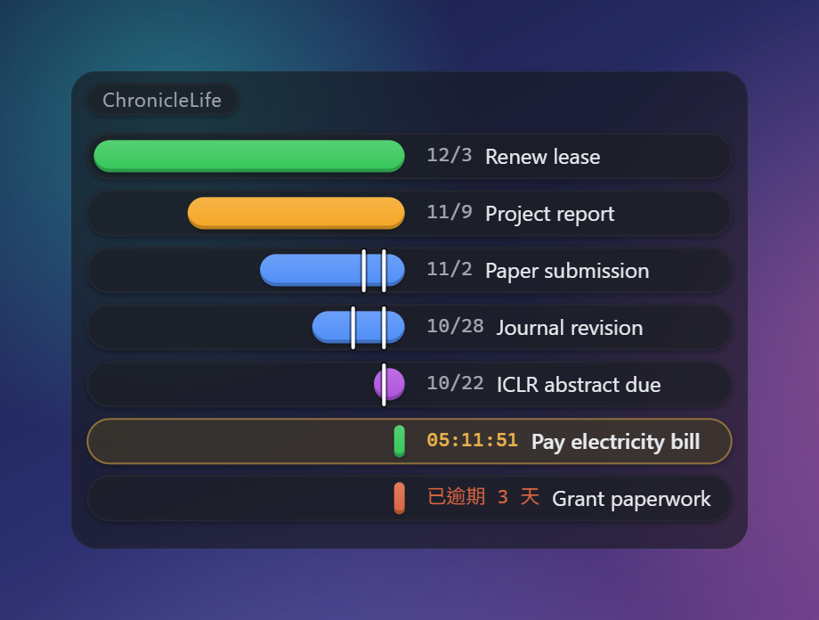
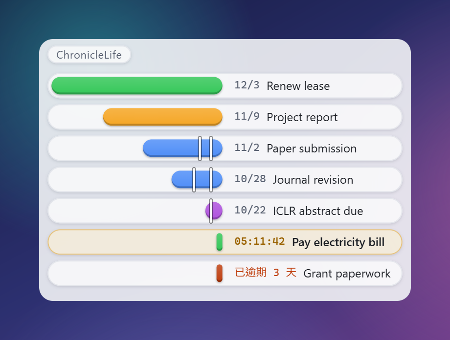
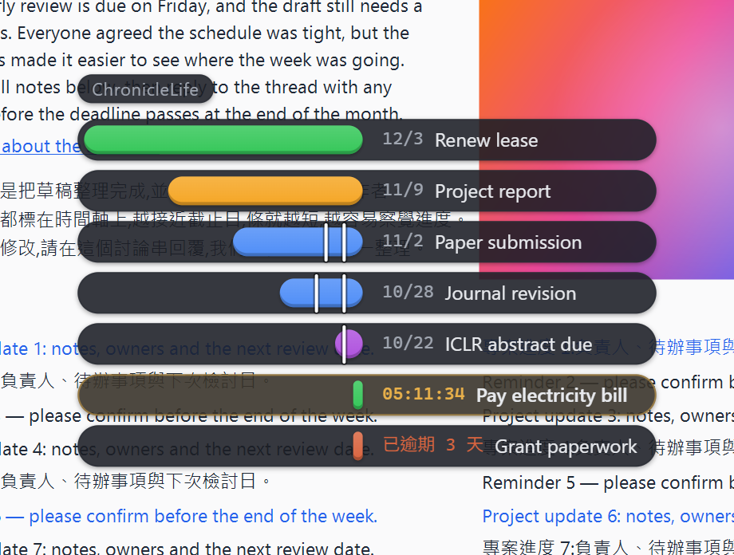
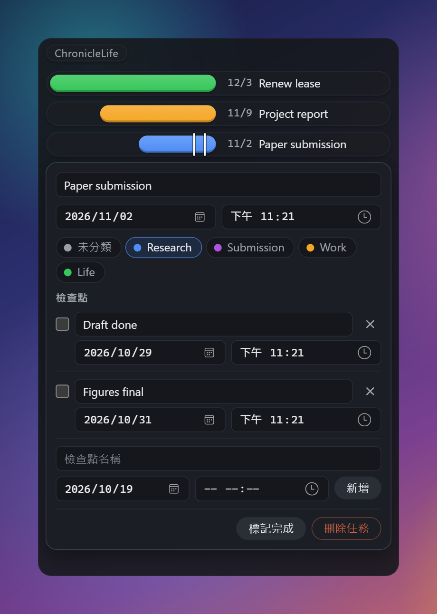

# ChronicleLife

**English** · [繁體中文](README.zh-Hant.md)

**A quiet desktop countdown timeline.** Every deadline is a bar that shrinks as time runs out.



ChronicleLife pins a small strip to the edge of your screen. Each deadline is a coloured bar inside a capsule: the capsule is the whole time window (30 days by default) and the bar is what is left of it. The closer a deadline gets, the shorter its bar and the lower it sits. The last 24 hours turn into a live `HH:MM:SS` countdown. Everything is stored in a local file: no account, no cloud, and it works offline.

> **Heads-up:** the interface is in Traditional Chinese for now. Task titles can be in any language; the screenshots here use English titles and sample data.

<table>
  <tr>
    <td></td>
    <td></td>
  </tr>
  <tr>
    <td align="center">Light theme (or dark, or follow the system)</td>
    <td align="center">Clear background over a busy page: text sits on capsules, so it stays readable</td>
  </tr>
  <tr>
    <td></td>
    <td></td>
  </tr>
  <tr>
    <td align="center">Click a row to edit it, add checkpoints, mark it done</td>
    <td align="center">Settings take effect immediately</td>
  </tr>
</table>

## Features

- **Bars that shrink.** A bar's length is the time left, measured against a window of 7–90 days (30 by default). Deadlines beyond the window are drawn full length, or hidden if you prefer. The most urgent one sinks to the bottom; overdue ones sit below it as "已逾期 N 天" (N days overdue), in red or grey.
- **Checkpoints.** Add intermediate marks to any deadline (say, "draft done"). They stay fixed on the bar, so you watch the shrinking bar close in on them. A due checkpoint turns red and glows once; tick it off when you are done.
- **A live countdown for the last day.** Inside the countdown threshold (12, 24 or 48 hours, or your own) a row switches from its date to `HH:MM:SS`. An optional blink is available.
- **The next deadline stands out.** It gets an amber outline, so you know where to look.
- **Categories.** Your own names and colours. Deleting a category moves its tasks to "uncategorized".
- **Quiet by default.** Frameless, transparent, docked to the left or right edge, always on top (switchable), and it remembers where you put it. The controls appear only when you hover over the window. The tray icon shows or hides it (left click) or quits (right-click menu). Launch at login is optional.
- **Readable on any background.** Text always sits on a capsule. Pick a solid, translucent or clear window; the more transparent the window, the more opaque the capsules, so the text keeps its contrast over a wallpaper or a web page.
- **Light, dark, or follow the system.** Row spacing, bar height and font size are adjustable, and every setting applies at once.

## Download

Get `chroniclelife.exe` from the [latest release](https://github.com/Zaious/chroniclelife/releases/latest): a single portable executable with no installer. Double-click to run. It needs the Microsoft Edge WebView2 runtime, which Windows 11 includes. The executable is not code-signed, so Windows SmartScreen may ask you to confirm (More info → Run anyway). Windows only for now.

## Using it

- **Hover** over the window to reveal the controls: pin on top, add, settings, quit.
- **Add** with `+`: a title, a date, an optional time (it defaults to 23:59) and a category.
- **Click a row** to edit its title, deadline and category, manage its checkpoints, mark it done or delete it. `Esc` closes the editor.
- **Drag the top strip** to move the window. Choose the left or right edge in the settings and the window snaps to it.

## Your data

Everything lives in `%APPDATA%\life.chronicle.app\`: `data.json` (tasks and categories) and `settings.json`. Moving the executable does not affect your data. Writes are atomic (a temporary file, then a rename), and if the data file cannot be read, ChronicleLife starts in read-only mode instead of overwriting it. Times are stored as ISO 8601 with a UTC offset.

There is no account, no server and no analytics, and the app makes no network requests of its own. The one link it can open is this repository, in your browser, when you click it in the settings.

## Development

Built with Tauri 2 (Rust), Svelte 5 / SvelteKit 2, TypeScript and Vite. You need Node.js and the Rust toolchain (on Windows, WebView2 as well, which Windows 11 includes).

```bash
npm install          # install frontend dependencies (first time, or after they change)
npm run tauri dev    # development mode, opens the desktop window
npm run check        # svelte-check type check
npm test             # vitest unit tests (core modules)
```

After changing the Rust side, `cargo check` in `src-tauri/` is a quick compile check.

```bash
npm run tauri build
```

builds the portable executable at `src-tauri/target/release/chroniclelife.exe` (no installer is produced).

Pushing a `v*` tag makes GitHub Actions build the executable and publish a release straight away, with a one-line note (see `.github/workflows/release.yml`). To cut a release:

1. Set the new version in `package.json`, `src-tauri/Cargo.toml` and `src-tauri/tauri.conf.json`, and keep `package-lock.json` and `src-tauri/Cargo.lock` in step with it. (`npm version` only touches the first one and its lockfile, so it is not enough on its own.)
2. Commit, then tag and push the tag by name. The existing tags are lightweight, which `git push --follow-tags` does not push.

```bash
git commit -am "chore: release vX.Y.Z"
git tag vX.Y.Z
git push origin main vX.Y.Z
```

3. The release note is a fixed one-liner; replace it afterwards with `gh release edit vX.Y.Z --notes-file <file>`.

The product spec is in [docs/PLANNING.md](docs/PLANNING.md) and the visual rules are in [docs/DESIGN.md](docs/DESIGN.md); both are in Traditional Chinese.

## License

By [Zaious](https://github.com/Zaious) · [MIT](LICENSE)
