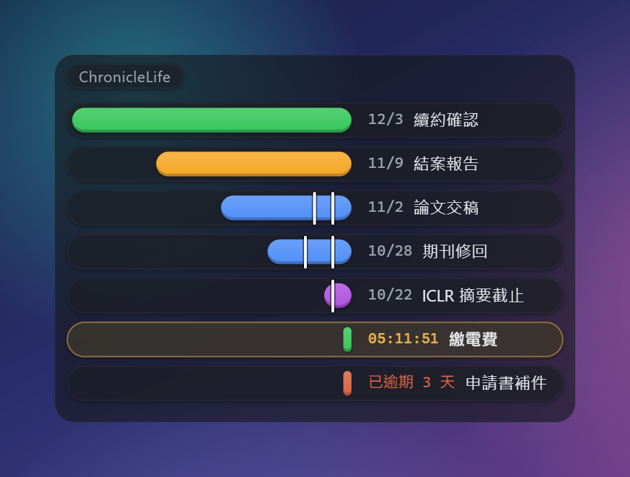
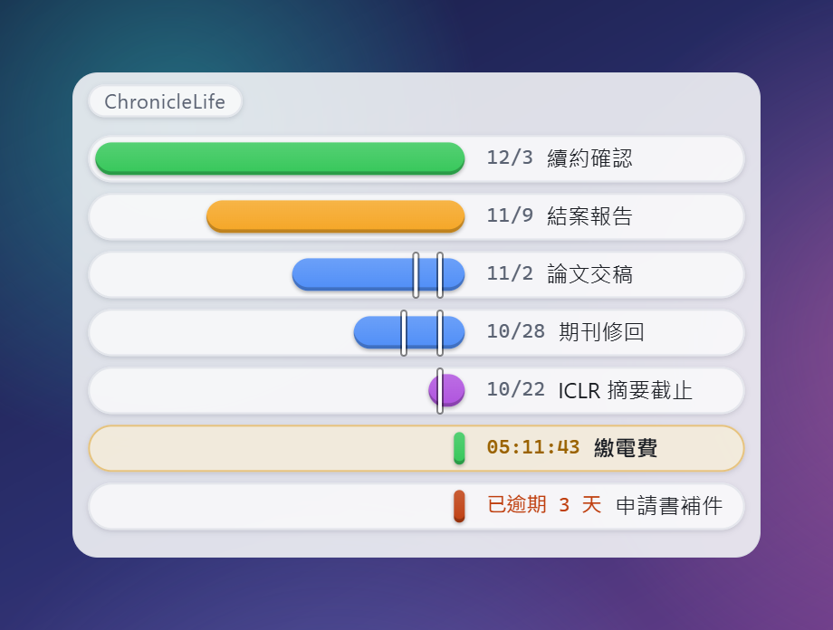
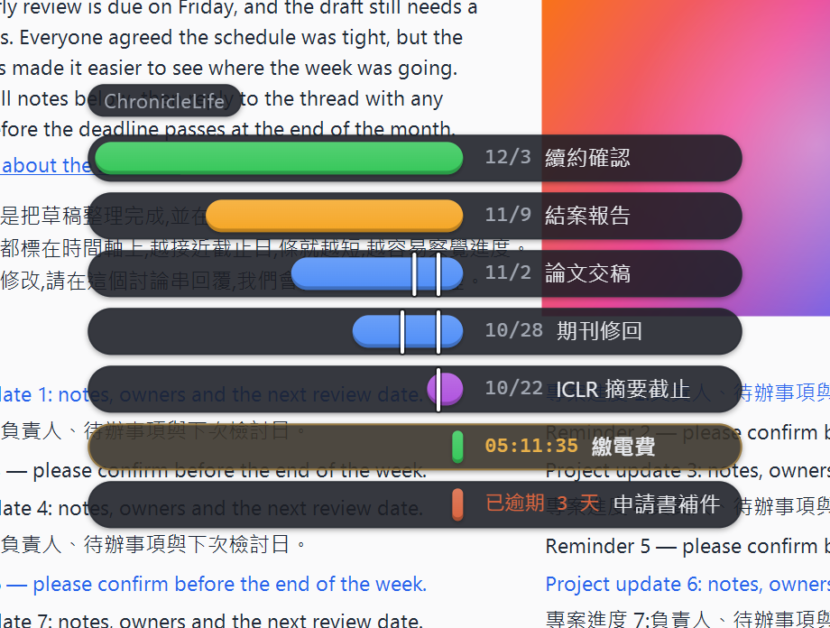
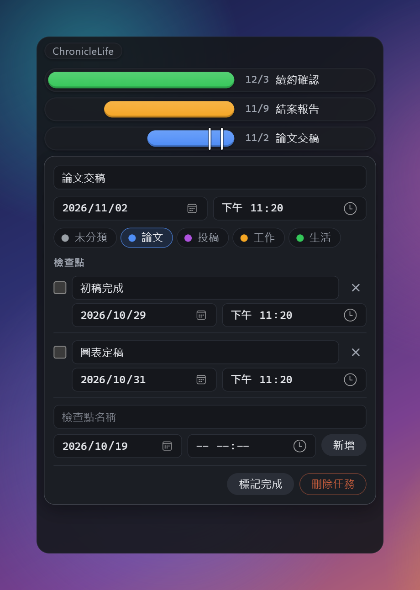
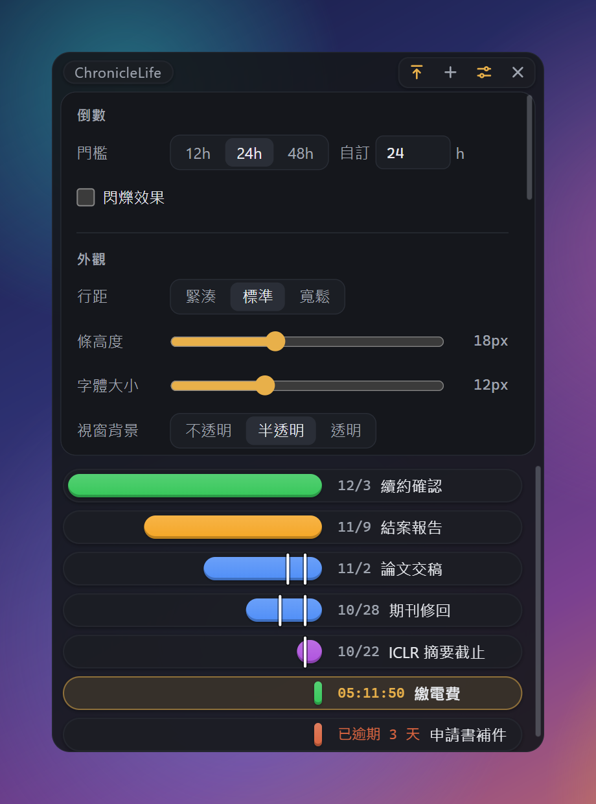

# ChronicleLife

[English](README.md) · **繁體中文**

**一個安靜的桌面倒數時間軸。** 每個截止日是一條隨時間縮短的長條。



一個釘選在桌面邊緣的輕量倒數時間軸 Widget。每個截止日是膠囊裡的一條彩色長條:膠囊是整段時間視窗(預設 30 天),長條是還剩下的部分。越接近截止,條越短、排得越下面;最後 24 小時會變成即時的 `HH:MM:SS` 倒數。所有資料存在本機檔案,離線運作,無帳號、無雲端。

> 範例畫面使用的是示範資料。

<table>
  <tr>
    <td></td>
    <td></td>
  </tr>
  <tr>
    <td align="center">淺色主題(也有深色,或跟隨系統)</td>
    <td align="center">全透明疊在雜亂的網頁上:文字坐在膠囊上,依然清楚</td>
  </tr>
  <tr>
    <td></td>
    <td></td>
  </tr>
  <tr>
    <td align="center">點一列就能編輯、加檢查點、標記完成</td>
    <td align="center">設定即時生效</td>
  </tr>
</table>

## 特色

- **會縮短的長條。** 條的長度就是剩餘時間,以 7–90 天(預設 30 天)的視窗為尺。超過視窗的項目畫成滿條,也可以選擇隱藏。最緊急的排在最底;已逾期的排在它下面,顯示「已逾期 N 天」,紅色或灰色。
- **檢查點。** 每個截止日可以加中途的檢查點(例如「初稿完成」)。它們固定在條上,你看著縮短的條逼近那條線。到期的檢查點會變紅、發一次光;完成後打勾。
- **最後一天的即時倒數。** 進入倒數門檻(12、24、48 小時,或自訂)後,該列由日期改成 `HH:MM:SS`。可選擇閃爍。
- **下一件很醒目。** 以琥珀色外框標出,一眼就知道該看哪裡。
- **分類。** 自訂名稱與顏色;刪除分類時,底下的任務會歸入「未分類」。
- **預設很安靜。** 無邊框、透明、靠左或靠右停靠、可切換置頂,並記住位置。控制列只有在滑鼠移上去時才出現。系統匣圖示左鍵顯示/隱藏,右鍵選單可離開。開機自啟是選配。
- **任何背景都讀得清楚。** 文字一律坐在膠囊上。視窗可選不透明、半透明、全透明;視窗越透明,膠囊越實,文字疊在桌布或網頁上仍有足夠對比。
- **淺色、深色,或跟隨系統。** 行距、條高度、字體大小都能調,所有設定即時生效。

## 下載

到 [Releases](https://github.com/Zaious/chroniclelife/releases/latest) 頁下載最新版的 `chroniclelife.exe` — 免安裝單一執行檔,雙擊即用(Win11 內建 WebView2,無需額外安裝)。執行檔未經程式碼簽章,Windows SmartScreen 可能會跳出警告(展開警告視窗的詳細資訊,再選「仍要執行」)。目前只支援 Windows。

> 上面的截圖是目前 `main` 分支的樣子;改版之前發布的版本外觀不同。

## 使用

- **滑鼠移上去**會浮出控制列:置頂、新增、設定、離開。
- **新增**按 `+`:標題、日期、選填的時間(沒填就是當日 23:59)與分類。
- **點一列**可以改標題、截止日與分類,管理檢查點,標記完成或刪除。`Esc` 關閉編輯面板。
- **拖曳頂端那一條**移動視窗。在設定裡選靠左或靠右,視窗會吸附到該邊。

## 你的資料

全部放在 `%APPDATA%\life.chronicle.app\`:`data.json`(任務與分類)與 `settings.json`。搬動執行檔不影響資料。寫入是原子的(先寫暫存檔再改名);若資料檔讀不起來,ChronicleLife 會進入唯讀模式而不是把它蓋掉。時間一律存成含時區偏移的 ISO 8601。

沒有帳號、沒有伺服器、沒有分析,app 本身也不會發出任何網路請求。它唯一能開的連結是本專案的 GitHub 頁面,而且要你在設定裡點了才會用瀏覽器開啟。

## 開發

技術棧:Tauri 2(Rust)+ Svelte 5 / SvelteKit 2 + TypeScript + Vite。需要 Node.js 與 Rust toolchain(Windows 上另需 WebView2,Win11 內建)。

```bash
npm install          # 安裝前端依賴(首次或依賴變動後)
npm run tauri dev    # 開發模式,啟動桌面視窗
npm run check        # svelte-check 型別檢查
npm test             # vitest 單元測試(core 模組)
```

Rust 端變更後,可在 `src-tauri/` 下執行 `cargo check` 做快速編譯檢查。

## 打包

```bash
npm run tauri build
```

編譯完成後,免安裝執行檔位於 `src-tauri/target/release/chroniclelife.exe`(不產生安裝檔)。

## 發布

推送 `v*` 標籤即由 GitHub Actions 自動編譯並建立 Release(見 `.github/workflows/release.yml`):

```bash
npm version patch          # 更新版號並產生 commit + tag
git push --follow-tags
```

完整產品規格見 [docs/PLANNING.md](docs/PLANNING.md),視覺規範見 [docs/DESIGN.md](docs/DESIGN.md)。

## 授權

作者:[Zaious](https://github.com/Zaious) · 授權:[MIT](LICENSE)
